# MomentSearch workshop: video RAG, hands on

[](https://colab.research.google.com/github/hamzafarooq/momentsearch-workshop/blob/main/quickstart.ipynb)
[](https://colab.research.google.com/github/hamzafarooq/momentsearch-workshop/blob/main/momentsearch_workshop.ipynb)


Ask a question about a video and get back the exact moments that answer it: what was **said**, and what was **on screen**. A transcript alone misses half of a video. This workshop indexes both halves, merges them into moments, refuses when the evidence is thin, and measures itself with an answer key.


## Two notebooks

| | Notebook | What it is |
|---|---|---|
| **In class** | [`quickstart.ipynb`](quickstart.ipynb) · [Colab](https://colab.research.google.com/github/hamzafarooq/momentsearch-workshop/blob/main/quickstart.ipynb) | Three videos already indexed. Ask, look inside one search, measure it with an answer key, add a video of your own, open the app. About 30 minutes. |
| **Homework** | [`momentsearch_workshop.ipynb`](momentsearch_workshop.ipynb) · [Colab](https://colab.research.google.com/github/hamzafarooq/momentsearch-workshop/blob/main/momentsearch_workshop.ipynb) | Every step built one cell at a time, plus the Prefect pipeline with retries and the storage math at 100,000 videos. |

**Before you run either:** Runtime → Change runtime type → **T4 GPU**, then add `OPENAI_API_KEY` under Secrets (key icon, left) with notebook access on. That is the only key.

## Architecture

Two paths that never share a request. Adding a video is slow and happens once. Asking is fast and happens every time.

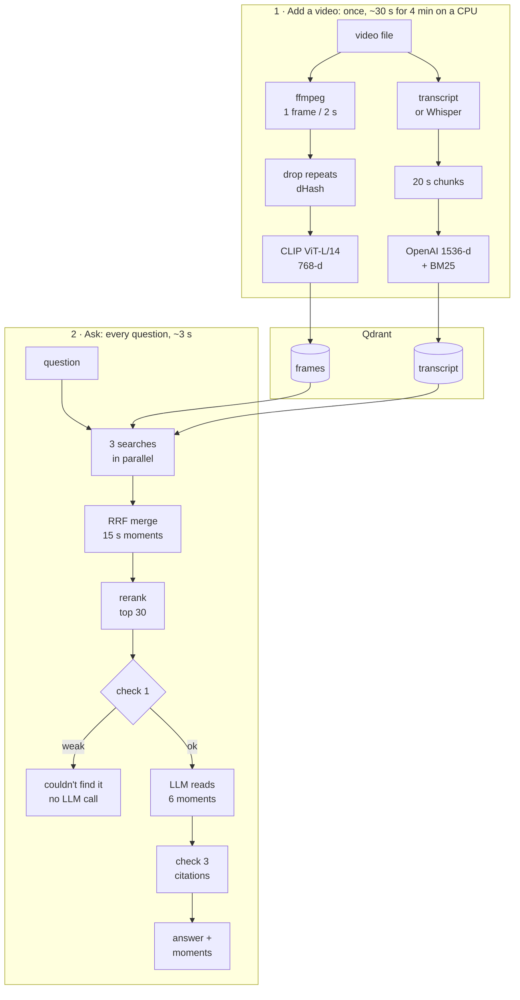

### Adding a video

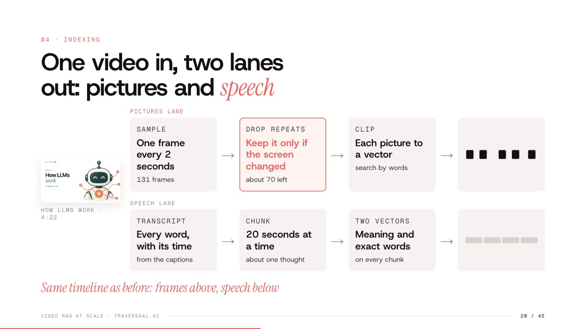

| Step | What happens | How LLMs work (4:21) |
|---|---|---|
| Sample | ffmpeg decodes once, keeps one frame every 2 s, shrinks it to 480 px, pipes JPEGs into memory | 15,700 frames → **131** |
| Drop repeats | 9×8 grey dHash; a frame within 4 bits of the last kept one is dropped | 131 → **71** |
| Pictures → vectors | CLIP ViT-L/14, 768 numbers per frame, unit length | 71 points |
| Words | transcript file, YouTube captions, or Whisper on the audio | 107 lines |
| Chunk | ~20 s per chunk: long enough to mean something, short enough to point at | **13** chunks |
| Two vectors per chunk | `text-embedding-3-small` (meaning) + BM25 sparse (exact words), one Qdrant point | 13 points |

Dropping repeats is the biggest saving and the first thing that can go wrong:

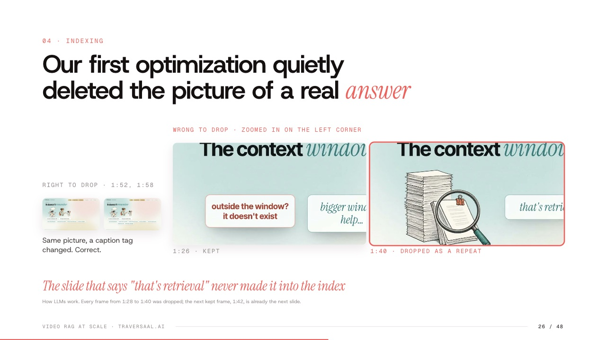

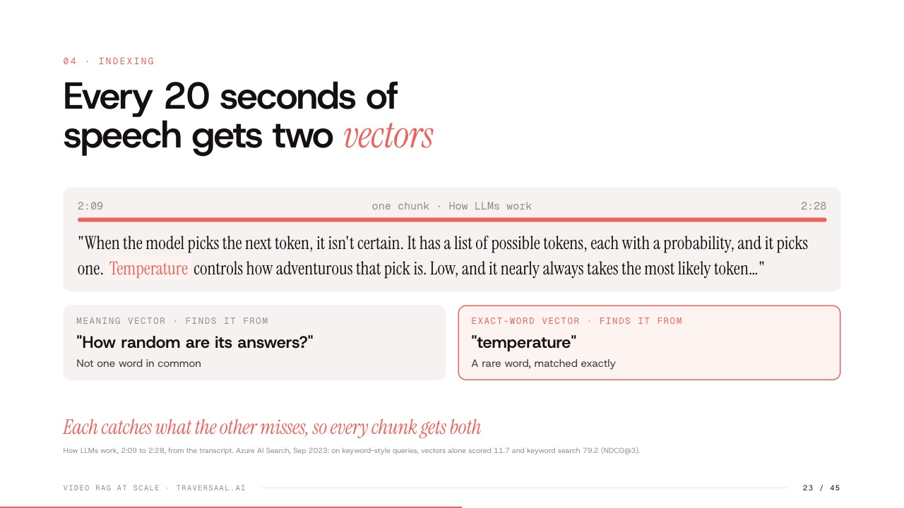

### Asking a question

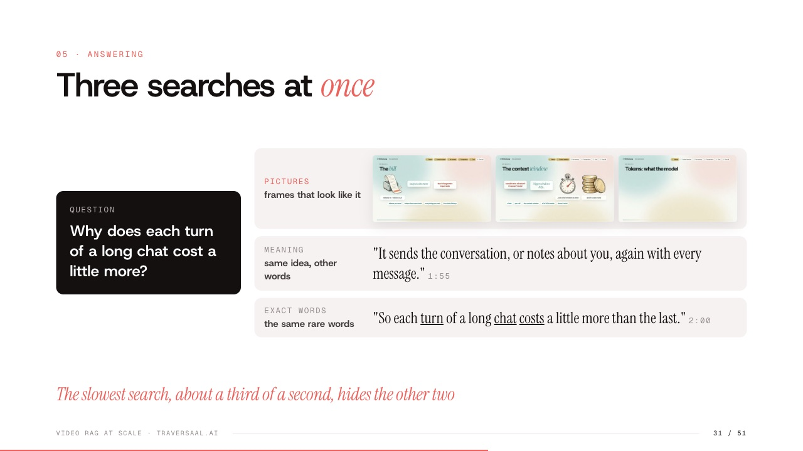

Cosine and BM25 scores live on different scales, so the lists are merged by rank (reciprocal rank fusion, `1 / (60 + rank)`), then hits within 15 seconds in the same video become one moment:

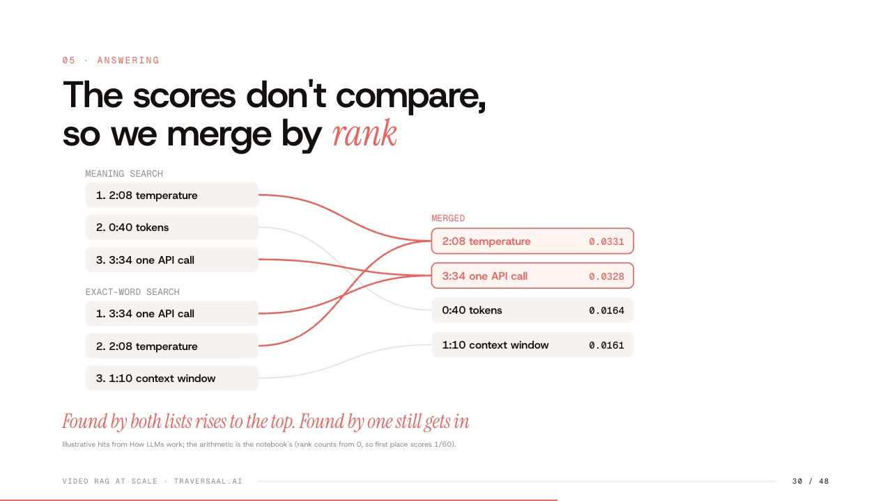

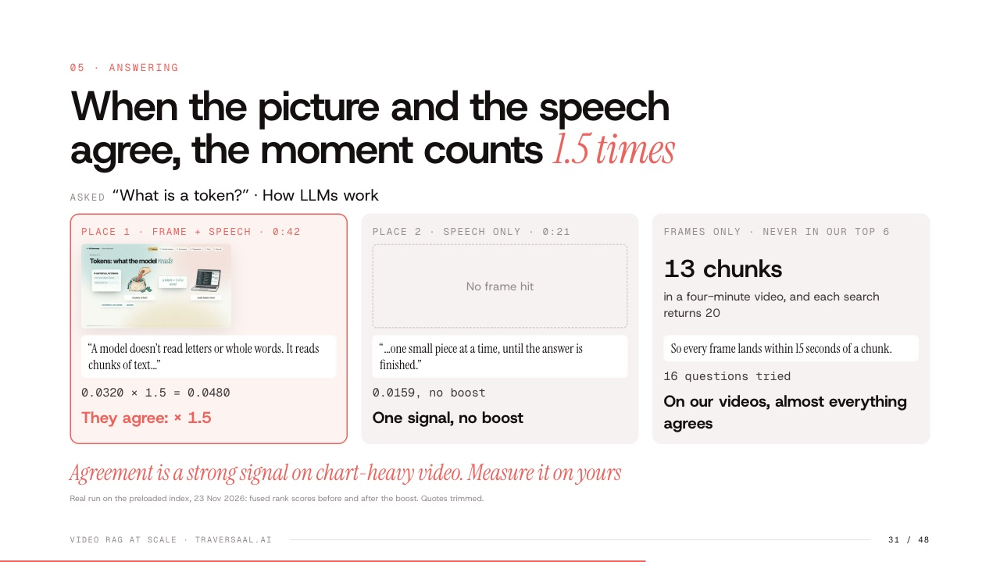

Two checks keep it from making things up. **Check 1** runs before the model: if the best picture match is under **0.24** and the best transcript match under **0.33**, it answers "I couldn't find that" without an LLM call. **Check 3** runs after: code deletes any `[n]` that points at a moment the model was never shown.

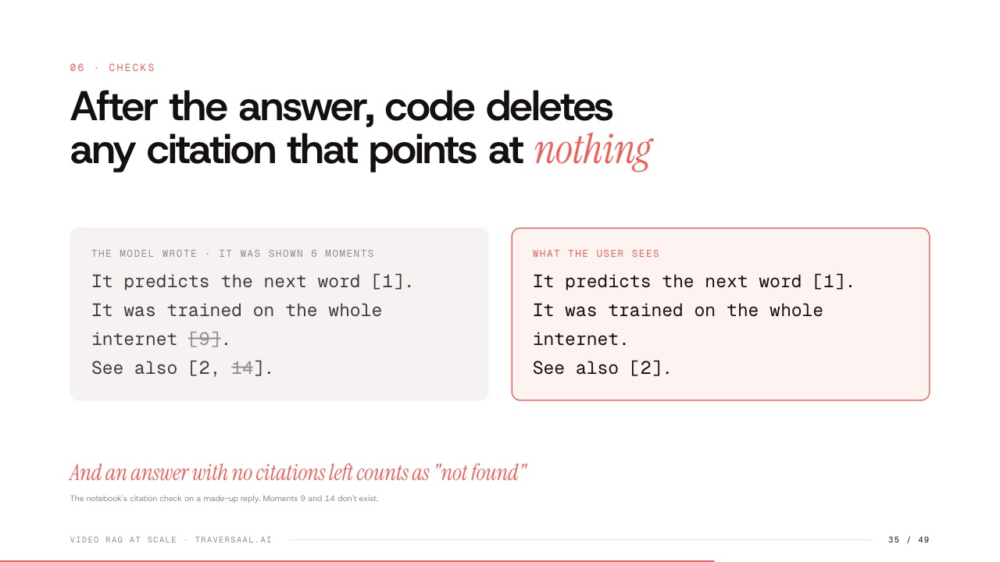

### At scale

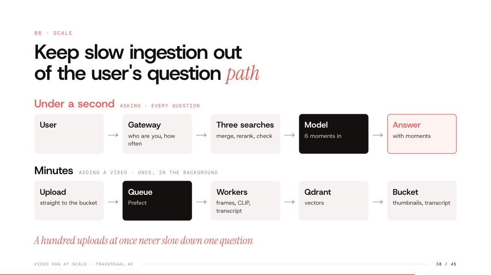

In production each ingestion step is a Prefect task with its own retry rule (fetch 2 retries at 30 s and 2 min, embed 2 at 60 s, transcript 1), so a failure reruns one step, not the whole video. The quickstart's `ms.add_video()` runs the same steps in order without Prefect; the from-scratch notebook runs the real flow.

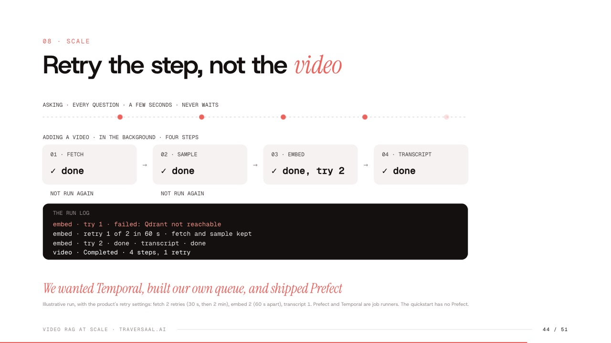

## Measured: the answer key

20 questions over the three videos with known answer windows: 9 **said**, 4 **shown**, 3 **both**, 4 **not in the videos** (must refuse). A hit is a returned moment within 15 s of the window. No LLM call, so the whole key runs in seconds.

| Search | found@6 | said | shown | both | MRR | refusal accuracy |
|---|---|---|---|---|---|---|
| transcript only | **94%** | 100% | 75% | 100% | 0.91 | 75% |
| pictures only | 50% | 67% | 0% | 67% | 0.30 | 100% |
| both (default) | 88% | 100% | 50% | 100% | 0.88 | 75% |

Read this honestly: on these three videos the transcript alone wins, because the speaker describes what is on screen, and with short videos nearly every moment is found by both a frame and the text, so the ×1.5 boost stops separating them. Benchmarks on chart-heavy video (CFVBench, above) show the opposite. Run the key on your own videos before you pick.

The gates (0.24 / 0.33) were chosen by sweeping this same key, which flatters these numbers. Test new questions before you trust them.

## The app

`ms.app()` (last cell of the quickstart, or `python app.py` locally) opens a Gradio app: ask with a 15-second clip of the moment, look inside the search, add a video. On Colab it also prints a public `gradio.live` link.

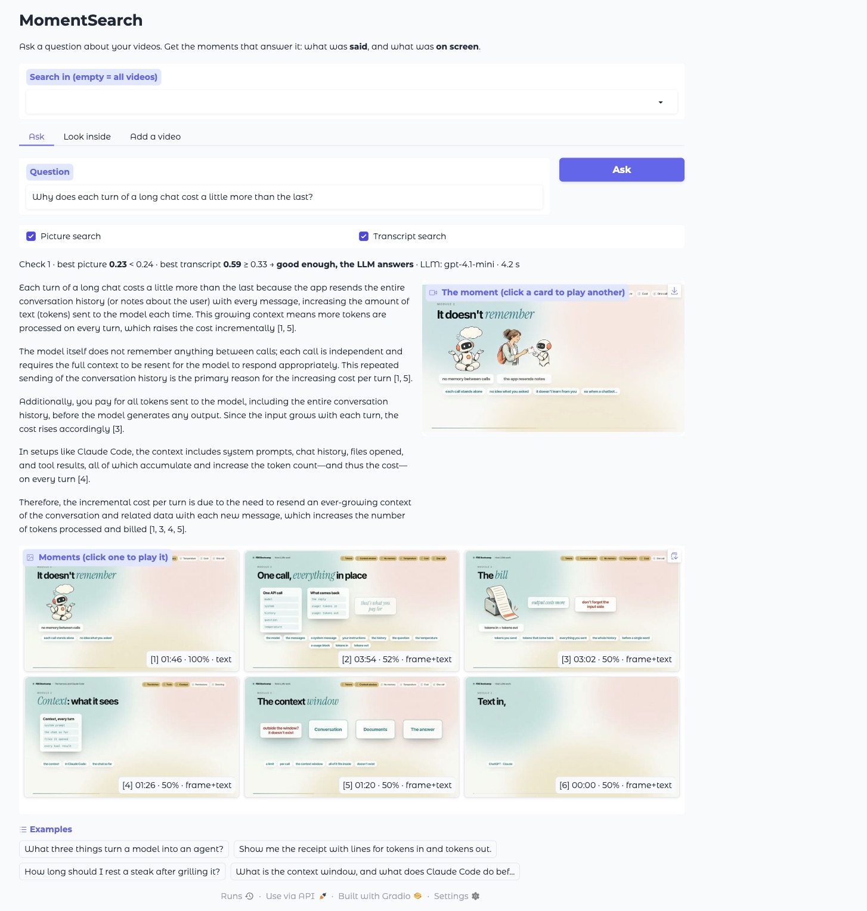

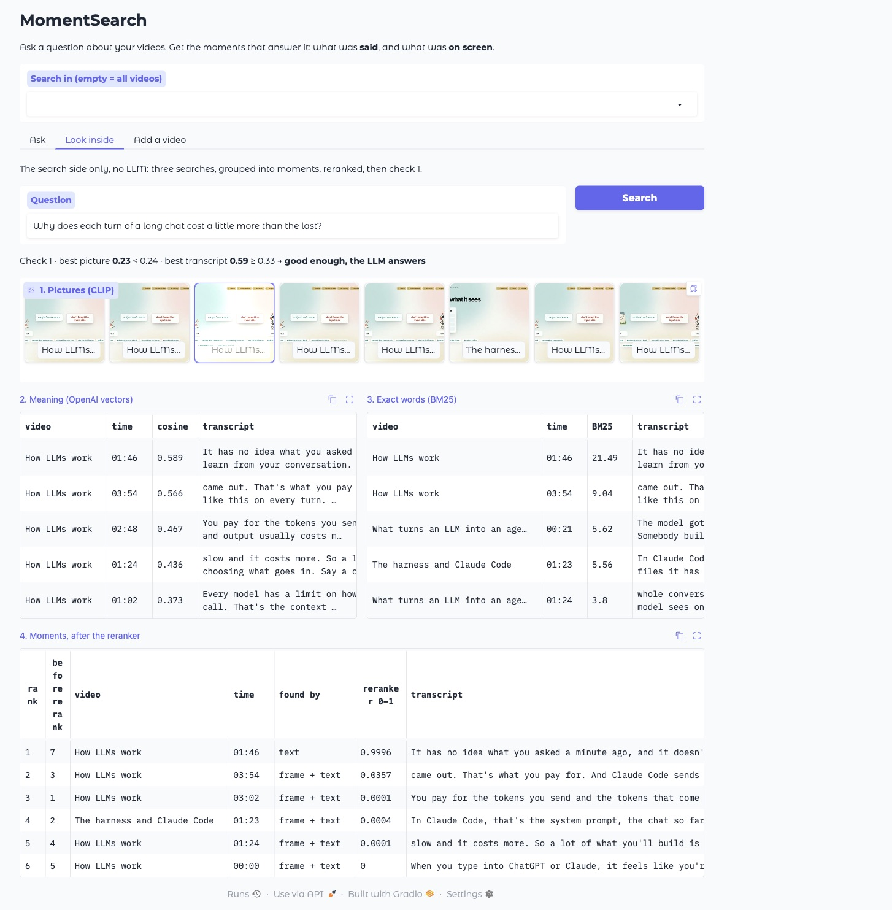

## The `ms` package

```python
import ms

ms.setup()                                  # key check, models, preloaded index
ms.ask("Why does each turn of a long chat cost more?")
ms.ask(q, use_frames=False)                 # switch a search off
ms.look_inside(q)                           # three searches, moments, rerank, check 1; no LLM
ms.report()                                 # answer key: found@6, MRR, refusal accuracy
ms.which_branch()                           # transcript only vs pictures only vs both
vid = ms.add_video("/content/my_talk.mp4")  # sample, dedup, CLIP, Whisper, chunks, Qdrant
ms.report([ms.Q("What did she say about pricing?", "said", vid, (95, 120))])
ms.app()
```

| File | What's in it |
|---|---|
| `ms/config.py` | every setting: models, collections, sampling, fusion, gates |
| `ms/core.py` | `setup()`, the models, the key (Colab secret, env var or `.env`), the bucket |
| `ms/store.py` | Qdrant collections: on-disk vectors, int8 copy in RAM, tenant index on `user_id` |
| `ms/ingest.py` | `add_video()`: fetch, sample, dedup, CLIP, transcript, chunks, upsert |
| `ms/search.py` | three searches, RRF, moments, rerank, check 1, `retrieve()` |
| `ms/answer.py` | the prompt, citation cleanup, multi-part questions, `ask_engine()` |
| `ms/evals.py` | the 20-question key, `report()`, `which_branch()` |
| `ms/app.py` | the Gradio app |
| `ms/show.py` | notebook display: `ask()`, `look_inside()`, `library()` |

## Run it on your own machine (optional)

Colab needs nothing installed, so use it in class. To run on a laptop:

1. **Python 3.10 to 3.12** and **ffmpeg** (macOS `brew install ffmpeg`, Ubuntu `sudo apt install ffmpeg`, Windows `winget install ffmpeg`).
2. Install (about 3 GB, mostly PyTorch and CLIP on first run):
   ```
   git clone https://github.com/hamzafarooq/momentsearch-workshop
   cd momentsearch-workshop
   python -m venv .venv
   source .venv/bin/activate        # Windows: .venv\Scripts\activate
   pip install -r requirements.txt
   ```
3. Put `OPENAI_API_KEY=sk-...` in a file named `.env` here (git ignores it).
4. `python app.py`, or open `quickstart.ipynb` in VS Code or Jupyter.

On a CPU, asking takes about 3 seconds and adding a 4-minute video about 30 to 40 seconds.

## What's in the repo

```
quickstart.ipynb            in class
momentsearch_workshop.ipynb homework: every step from scratch, with Prefect
app.py                      python app.py → the Gradio app
ms/                         the code the quickstart and the app call
data/                       the three demo videos, preindexed (Qdrant, thumbnails, transcripts, 5.8 MB)
videos/                     three ~4-minute course videos with timed transcripts
tools/build_index.py        rebuilds data/
tools/make_quickstart.py    writes quickstart.ipynb
docs/img/                   the images on this page
```

The videos (*How LLMs work*, *What turns an LLM into an agent*, *The harness and Claude Code*) and the slides are from the Forward Deployed Engineering Bootcamp by Traversaal.ai. The full product (API, web app, worker) is at [traversaal-ai/momentsearch](https://github.com/traversaal-ai/momentsearch).
